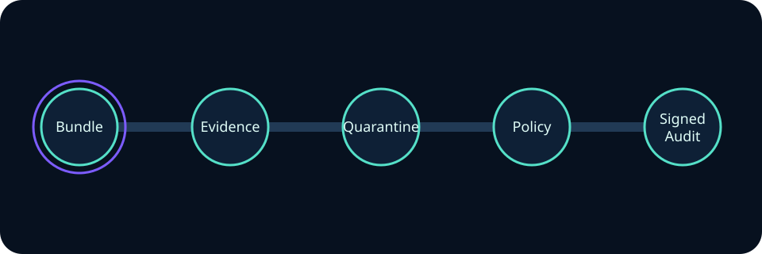
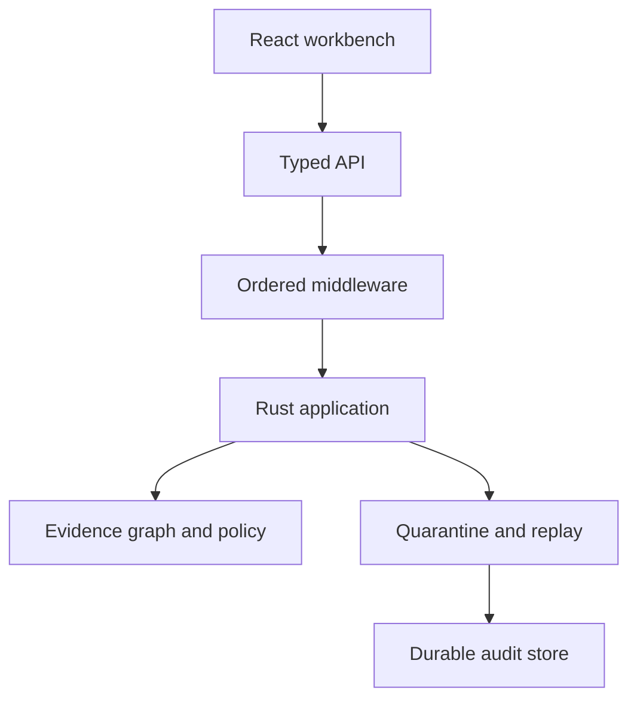
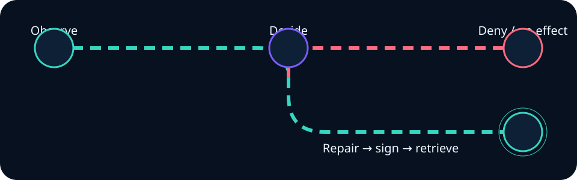

# Capability Provenance Mesh



Capability Provenance Mesh is a security workbench for teams that must decide whether a third-party agent capability may run. It turns a submitted bundle into an evidence graph, evaluates authority and reversibility, quarantines effects, produces a signed admission receipt, and preserves restart-durable audit and replay.

> Execution status is evidence-driven. This README does not claim a passing build until exact-head CI publishes the source-bound evidence artifact.

## Product surface

- **Intake and provenance:** hash, inspect, and quarantine a capability bundle.
- **Adaptive admission:** combine typed policy, graph evidence, and bounded repair.
- **Quarantine and replay:** prove denial has no downstream mutation, then replay a corrected bundle.
- **Attestation and audit:** sign admitted artifacts and retrieve the decision after refresh and backend restart.
- **Operator UI:** responsive React/TypeScript intake, evidence-graph, repair, replay, registry, and audit views.
- **Rust composition:** versioned Axum API, ordered middleware, application services, background work, and durable shared-storage boundaries.

## One-command local launch

```bash
cp .env.example .env
./scripts/start.sh
```

Open <http://127.0.0.1:4173>. The API is at <http://127.0.0.1:8080>; `/healthz` is liveness and `/readyz` verifies application readiness.

```bash
./scripts/seed.sh       # deterministic synthetic capability
./scripts/readiness.sh  # frontend + API
./scripts/stop.sh
./scripts/reset.sh      # stops and removes only the configured local state directory
```

Rootless container launch uses the same topology:

```bash
./scripts/start.sh --containers
./scripts/stop.sh --containers
```

## Architecture



The default production binary is `cpm-service`. Middleware order is correlation, observability, errors, timeout, authentication, validation, authorization, and policy. A denied request may append a denial audit event but cannot dispatch a capability, mutate the parent state, or advance the admitted pointer.

See [architecture](docs/architecture.md), [implementation contract](docs/implementation-contract.md), [integration matrix](docs/integration-matrix.md), [crate map](docs/crate-map.md), [call paths](docs/crate-to-backend-call-paths.md), and [prototype acceptance](docs/prototype-acceptance.md).

## Selected runtime composition

| Upstream | Product responsibility |
| --- | --- |
| ruvnet/autogenous | typed mutation, fitness gating, promotion, rollback |
| ruvnet/ruGraph | evidence graph, uncertainty and replay |
| ruvnet/agenticow | copy-on-write quarantine and parent isolation |
| ruvnet/ai-text-watermark | keyed provenance |
| ruvnet/LatentMesh | authenticated envelopes and replay rejection |
| NVIDIA/SkillSpector | capability inspection and severity |
| sigstore/cosign | offline signing and tamper rejection |

Each count requires an immutable revision, license, real call site, failure test, and source-bound runtime trace. The selection report is the authority for exact revisions.

## Verification

```bash
DREAM_MACHINE_EVIDENCE_DIR=/absolute/path/outside/checkout ./scripts/verify-prototype.sh
```

The collector executes ten suites: Rust, Cargo production graph, frontend, API drift, middleware, integrations, benchmark, ablations, rootless containers, and browser journeys. It records commands, separate backend stdout/stderr, timestamps, exit codes, and hashes. It never creates a PASS receipt for a failed command.

CI runs the same publication controller in `--check` mode and runs the Rust source-floor checker separately. Evidence remains external to the checkout to avoid circular hashes.

## Containers and Cloud Run

`compose.yml` defines a rootless, unprivileged, read-only local topology with explicit writable data and temporary mounts. `deploy/cloud-run-service.yaml` and `deploy/rollback.env.example` are configuration only. Nothing in this repository deploys, spends, merges, or weakens approval policy.

## Current results and limitations

- Benchmark, ablation, browser, and evidence results are **pending exact-head execution**.
- External upstream availability and platform sandbox behavior must be proven by the integration suite; imports or version output do not count.
- Local filesystem persistence is for authorized development/CI only. Production must bind an approved shared-storage backend.
- Cloud Run configuration is supplied but has not been deployed.
- Publication requires a non-draft PR and readback; `publish-via-pr.sh` refuses non-personal owners and never merges.


